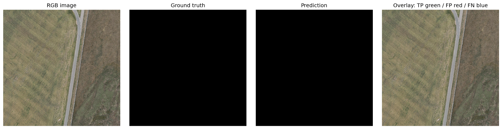
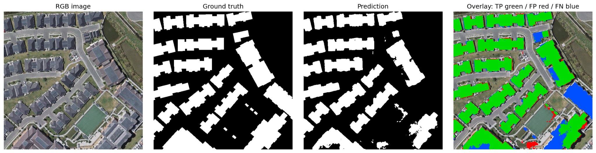
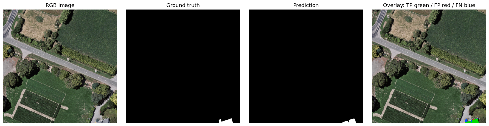
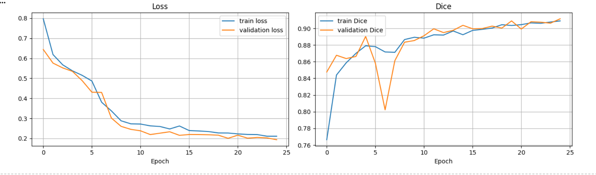

# AeroFootprint — WHU Aerial Building Segmentation

[](https://colab.research.google.com/github/dhruvjai45/AeroFootprint/blob/main/notebooks/AeroFootprint_WHU_Colab.ipynb)

AeroFootprint is a binary building-footprint segmentation project built with **TensorFlow/Keras**. It trains a custom four-level U-Net **from random initialization** on the WHU Building Dataset. The workflow includes paired image-mask loading, random crops, synchronized augmentation, BCE-Dice loss, learning-rate scheduling, checkpointing, validation-based threshold selection, and held-out test evaluation.

> **Model provenance:** no external pretrained weights were loaded. The reported model was trained from scratch.

## Results

The following metrics are from the held-out WHU test split of 1,228 tiles, using a probability threshold of **0.55 selected on the validation split only**.

### Primary results — micro (pixel-pooled)

| Metric | Test score |
|---|---:|
| Dice | **91.28%** |
| IoU | **83.96%** |
| Precision | **91.74%** |
| Recall | **90.83%** |

These are micro metrics: TP, FP, and FN are summed across all test pixels before calculating the scores. They are the recommended headline numbers for this run.

### Secondary results — macro (mean per image)

| Metric | Test score |
|---|---:|
| Dice | 89.47% |
| IoU | 83.36% |
| Precision | 91.42% |
| Recall | 90.32% |

**Metric caveat:** 223 test tiles have empty ground-truth masks; 211 of those also have empty predictions. The current per-image macro calculation assigns 1.0 to empty-ground-truth/empty-prediction cases. For that reason, use the micro metrics as the primary reported results and inspect the per-image CSV for detailed behavior.

### Qualitative predictions

The panels show RGB input, ground truth, prediction, and an overlay (green = true positive, red = false positive, blue = false negative).

| Example 1 | Example 2 | Example 3 |
|---|---|---|
|  |  |  |

Training curves from the 25-epoch run:



## Dataset

- **Dataset:** [WHU Building Dataset mirror on Hugging Face](https://huggingface.co/datasets/giswqs/WHU-Building-Dataset)
- **Reported split sizes:** 5,732 training, 1,228 validation, and 1,228 test tiles.
- **Tile format:** 512 × 512 RGB PNG images with corresponding binary masks.
- **Mask convention:** 0 = background; 255 = building (converted to binary masks during loading).
- **Dataset license:** CC BY 4.0, as declared by the Hugging Face dataset card. See the source dataset card for attribution and license terms.

The notebook downloads the public dataset directly from Hugging Face. **No AWS account or Hugging Face token is required.** Raw data is not included in this repository.

## Model and training setup

| Setting | Value |
|---|---|
| Architecture | Custom four-level U-Net |
| Initialization | Random; no pretrained weights |
| Framework | TensorFlow / Keras |
| Model input | 256 × 256 × 3 |
| Source tile | 512 × 512 RGB |
| Training crop | Random 256 × 256 crops |
| Base filters | 32 |
| Batch size | 8 |
| Epoch limit | 25 |
| Optimizer | Adam |
| Initial learning rate | 1e-4 |
| Loss | Binary cross-entropy + Dice loss |
| Threshold | 0.55, selected using validation data |
| Random seed | 42 |

The training notebook uses learning-rate reduction, best-validation-Dice checkpointing, early stopping, and backup/recovery support.

## Run in Google Colab

1. Open [`notebooks/AeroFootprint_WHU_Colab.ipynb`](notebooks/AeroFootprint_WHU_Colab.ipynb) in Google Colab using the badge at the top of this README.
2. In Colab, select **Runtime → Change runtime type → T4 GPU** (or another available GPU).
3. Run the notebook cells from top to bottom and authorize Google Drive when prompted.
4. The notebook downloads the public dataset, verifies image-mask pairs, trains the U-Net, selects a threshold on validation data, and evaluates once on the held-out test split.
5. Checkpoints and evaluation outputs are saved to `MyDrive/AeroFootprint/runs/whu_unet_v1/`.

Colab GPU availability and session duration depend on the account and current resource availability. If a run is interrupted, reconnect and follow the notebook's recovery instructions using the same run ID.

## Repository layout

```text
AeroFootprint/
├── notebooks/
│   └── AeroFootprint_WHU_Colab.ipynb
├── results/
│   ├── metrics_per_image.csv
│   └── figures/
│       ├── training_curves.png
│       ├── test_0001_comparison.png
│       ├── test_0002_comparison.png
│       └── test_0003_comparison.png
├── .gitignore
└── README.md
```

## Reproducibility and limitations

- The notebook is the executable implementation for this repository; the dataset is downloaded separately at runtime.
- `results/metrics_per_image.csv` contains per-tile test counts and metrics for all 1,228 test tiles.
- The model was evaluated on the published WHU test split. These results describe this dataset and setup; they should not be assumed to transfer unchanged to other cities, sensors, image resolutions, or acquisition conditions.
- The Hugging Face PNG mirror does not provide per-tile GeoTIFF affine transforms. Any contours exported by this notebook are in **image-pixel coordinates**, not latitude/longitude. Geographic footprint mapping requires georeferenced input imagery and its CRS/affine transform.
- Model checkpoints and raw dataset files are not committed. The notebook regenerates the model; large weights can be distributed separately (for example, via Git LFS or a model repository) if needed.

## Reference

Ji, S., Wei, S., & Lu, M. (2019). *Fully convolutional networks for multisource building identification*. IEEE Transactions on Geoscience and Remote Sensing, 57(1), 108–120.

Dataset source: [giswqs/WHU-Building-Dataset](https://huggingface.co/datasets/giswqs/WHU-Building-Dataset). Please follow the dataset card's CC BY 4.0 attribution requirements.

---

**Project title:** AeroFootprint - WHU Aerial Building Segmentation  
**Repository name:** `AeroFootprint`
